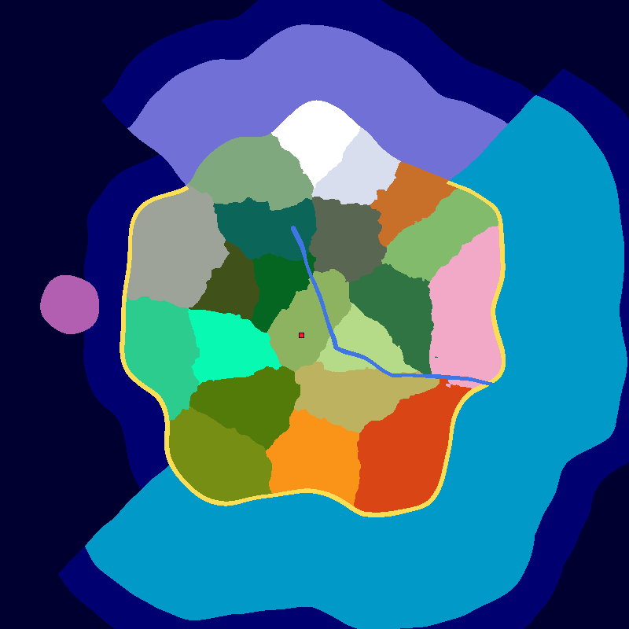

# The Continent

A Minecraft mod that adds one world type, **The Continent**. It's a single
hand-laid continent, 900 to 1100 blocks from its centre to the shore, in an endless ocean. It holds the smallest set of
overworld biomes that still covers every obtainable block, and it has one guaranteed village at a fixed
spot. The layout is the same on every seed. The seed only changes local detail: the coast wobbles by up to
32 blocks, borders between biomes are ragged by up to 24 more, and hills, ores and structure positions vary.
The Nether and the End are vanilla.



*Seed 12345 on Minecraft 26.3, exported with `/continent map` (1600-block radius, 4 blocks per pixel). North is
up, and the red square is the guaranteed village. The orange region in the north-east is Dappled Forest, which
only 26.3 has: on 26.1 and 26.2 the Taiga, Old Growth Pine Taiga and Meadow around it fill that spot. Sulfur
Caves (26.2 and newer) is underground, so it isn't on this surface map.*

## Supported versions

From **1.0.0**, each release has one jar per Minecraft band and loader, named
`the_continent-<version>+<loader>-mc<band>.jar`. Pick the loader you run and the band that holds your Minecraft
version:

| Minecraft | Fabric and Quilt | NeoForge | Forge | Map |
|---|---|---|---|---|
| **26.1 – 26.1.2** | `mc26.1`: 26.1 – 26.1.2 | `mc26.1.2`: 26.1.2 only | `mc26.1.2`: 26.1.2 only | The base map |
| **26.2** | `mc26.2` | `mc26.2` | `mc26.2` | Adds Sulfur Caves |
| **26.3** | `mc26.3` | `mc26.3` | `mc26.3` | Adds Sulfur Caves and Dappled Forest |
| **1.21.11** | 0.2.0 only: `the_continent-0.2.0.jar` | No | No | The base map. Frozen on branch `mc/1.21.11`: critical fixes only |

Quilt runs the Fabric jar, so there is no separate Quilt jar. CI boots each band's Fabric jar on Quilt Loader
0.31.0-beta.4, the only Quilt line for 26.x. NeoForge and Forge have no stable build for 26.1 or 26.1.1, so their
26.1 jars run on 26.1.2 only.

Minecraft 26.2 and 26.3 add biomes that are the only natural source of some blocks, so those bands' maps add them:
**Sulfur Caves** (cinnabar, sulfur, potent sulfur, sulfur spikes) from 26.2, and **Dappled Forest** (poplar, red
shrubs, shelf mushrooms) from 26.3. A world keeps the chunks it already generated when you move it to a newer
band. Only chunks generated after that get the new biomes, so they can meet the old ones at a seam.

## The map

| Region | Biomes |
|---|---|
| Centre | **Plains** (spawn), Sunflower Plains, Forest. A river runs from the north-centre to the east coast |
| North | Taiga, Old Growth Pine Taiga, Grove, Snowy Slopes, and Jagged Peaks (up to y ~300). The mountains drop straight into a Frozen Ocean band. On 26.3, Dappled Forest sits in the north-east foothills |
| East | Birch Forest, Meadow, Cherry Grove |
| South | Savanna, Desert, Badlands |
| West | Dark Forest, Pale Garden, Swamp, Mangrove Swamp |
| Southwest | Jungle, Bamboo Jungle |
| Island | Mushroom Fields, about 1250 blocks west, across a 100-block channel |
| Coasts | Bays and headlands all round: a Jagged Peaks headland in the north, the Badlands peninsula in the south-east, a Bamboo Jungle headland in the south-west, and bays between them. Beach on the south, east and west coasts. Warm Ocean off the south and east, then Ocean, then Deep Ocean forever |
| Underground | Deep Dark under the north (z < −350, at y 0 and below), Dripstone Caves under the east and south, Lush Caves under the west and centre. On 26.2 and newer, Sulfur Caves under the north-east hills |

Terrain follows the map. Mountains stand in the north, with summits up to y ~300, lowlands sit in the middle, and each region has
its own height and roughness. The coasts slope down to a shelf, and deep water lies where the Deep Ocean
biome starts.

## The guaranteed village

Every Continent world has a plains village at **x −68, z 104**, a short walk south-west of spawn.
`/locate structure` won't find it, because it uses its own placement, so go by the coordinates.
On about 2% of seeds the village rolls as a zombie village. It still has its bell, beds and
workstations, but its villagers have to be cured before they trade.

## Installing

Download the jar for your loader and band (see [Supported versions](#supported-versions)) from the
[Releases](https://github.com/Wulfic/the-continent/releases) page and drop it into `mods/`. Each release
also lists the jars' SHA-256 sums in `SHA256SUMS`.

- **Fabric:** Fabric Loader 0.19.5 or newer and Fabric API. **Quilt:** the Fabric jar, with Quilt Loader and
  Fabric API.
- **NeoForge:** the `neoforge` jar. **Forge:** the `forge` jar. Neither needs another mod.

- **Singleplayer:** Create New World → World → World Type → **The Continent**.
- **Server:** in `server.properties`, before the world is first created:

  ```properties
  level-type=the_continent\:continent
  ```

  The colon is escaped because `server.properties` is a Java properties file. An existing world keeps the
  generator it was created with.

## Structures

The structures that are the only source of some block live in the ocean or underground, so they spread
across the endless ocean as usual. A census over three seeds finds each of them within 3000 blocks of
spawn:

- Ocean monument (sponge, prismarine, sea lantern)
- Warm ocean ruins (sniffer eggs)
- Buried treasure, on beaches (Heart of the Sea, for the conduit)
- Trial chambers (heavy core)
- Stronghold

Strongholds use vanilla's rings, 1280–2816 blocks out, so they sit under the sea floor. Expect to dig
or dive. Land structures (temples, igloo, outposts, mansion, trail ruins, ancient city, other villages)
follow vanilla spacing, so a given seed may lack some. None of them is the only source of any block.

## Commands

`/continent map [radius] [blocksPerPixel]` writes a biome map of your current dimension to
`<world>/continent-maps/map-<timestamp>.png`. Defaults: radius 1600, 4 blocks per pixel. It's for
admins (permission level 3+), so command blocks can't run it. It renders in the background, creates a
new file every time, and never overwrites one. Maps over 4096 pixels per side are refused.

## Building from source

Gradle has to run on a **JDK 25**, and the mod is compiled for Java 25, which Minecraft 26.x requires.

```sh
JAVA_HOME=/path/to/jdk-25 ./gradlew build
```

That builds one jar per loader and Minecraft band, `<loader>/versions/<band>/build/libs/the_continent-<version>+<loader>-mc<band>.jar`
for `fabric`, `neoforge` and `forge` (Quilt runs the Fabric jar). It also runs every band's unit tests and the
Fabric game tests (a headless server). `./gradlew :fabric:26.2:runServer` starts a dev server for one band.
`python tools/smoke_band.py --band 26.2 --loader neoforge --work <new folder>` boots a built jar on its loader's
real dedicated server and checks the world is a Continent one; CI does this for every loader and band.

Loader-free code lives in `common/`, and each loader compiles it into its own jar. The bands are
[Stonecutter](https://stonecutter.kikugie.dev/) nodes (`settings.gradle`). Code that differs between bands sits
in `//? if` comment blocks, and data that differs (the copied vanilla terrain JSON) sits in
`common/versions/<band>/src/main/resources`. The sources are committed with 26.1.2 active. To edit another
band's code as plain Java, run `./gradlew "Set active project to 26.2"`, and run
`./gradlew "Reset active project"` before committing. `tools/terrain_copies.py` regenerates a band's terrain
JSON from its Minecraft jar.

## CI and releases

`.github/workflows/build.yml` runs the same `./gradlew build` on every push to `main` and every pull
request, one leg per band, and attaches each band's jars to the run as `the_continent-jars-<band>`. To
publish a release:

1. Set `version=X.Y.Z` in `gradle.properties` and add a `## X.Y.Z` section to `CHANGELOG.md`. That
   section becomes the release notes.
2. Commit that to `main` and push it.
3. Tag the commit and push the tag:

   ```sh
   git tag -a vX.Y.Z -m "The Continent X.Y.Z"
   git push origin vX.Y.Z
   ```

   Or skip local git: on GitHub, open **Actions → Build → Run workflow** on `main` and enter `X.Y.Z`. That
   run tags `main`'s head as `vX.Y.Z` itself, but only pushes the tag after the guard below passes.

The tag's run builds and tests every band again, then `.github/scripts/release-guard.sh` checks the release
before anything is published. It refuses if the tag doesn't match `gradle.properties`, the commit isn't on
`main`, the changelog has no section for that version, or the jars don't match the band table in
`gradle.properties`: one jar and one sources jar per band and loader, nothing missing and nothing extra, each
declaring this version and its band's Minecraft range. Only then does it create the GitHub Release with every
jar, every sources jar and `SHA256SUMS`. A tag with a suffix such as
`v0.2.0-beta.1` becomes a pre-release, so `gradle.properties` must say `0.2.0-beta.1`. A release that already
exists is never overwritten. `bash .github/scripts/release-guard-test.sh` runs the guard's own tests.

## How it works

- `layout/ContinentLayout` is the map as plain Java: biome seed points (a domain-warped Voronoi diagram),
  the coast, river, island, ocean bands and cave regions. It's the single source of truth. Everything
  else reads it.
- `world/ContinentBiomeSource` (`the_continent:continent`) places biomes from the layout.
- `layout/ContinentTerrain` turns the layout into targets for vanilla's own terrain splines
  (continentalness, erosion, ridges): a profile per biome, a coast ramp, an ocean shelf, a river valley.
  Three `the_continent:layout` density functions feed those targets into an unmodified copy of vanilla's
  overworld noise graph. Normal worlds are untouched.
- `world/AnchoredPlacement` (`the_continent:anchored`) places the guaranteed village. It only fires in a
  world whose terrain comes from the layout.

## License

MIT. See [LICENSE](LICENSE).
